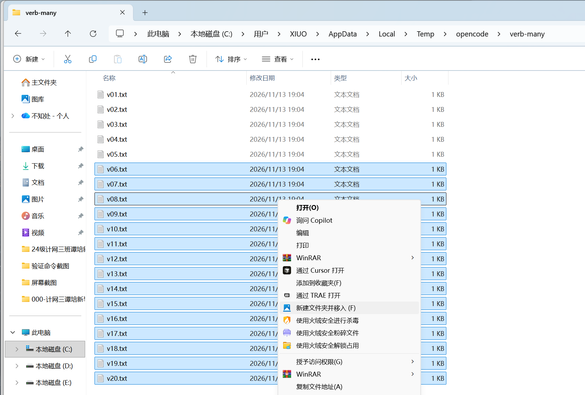
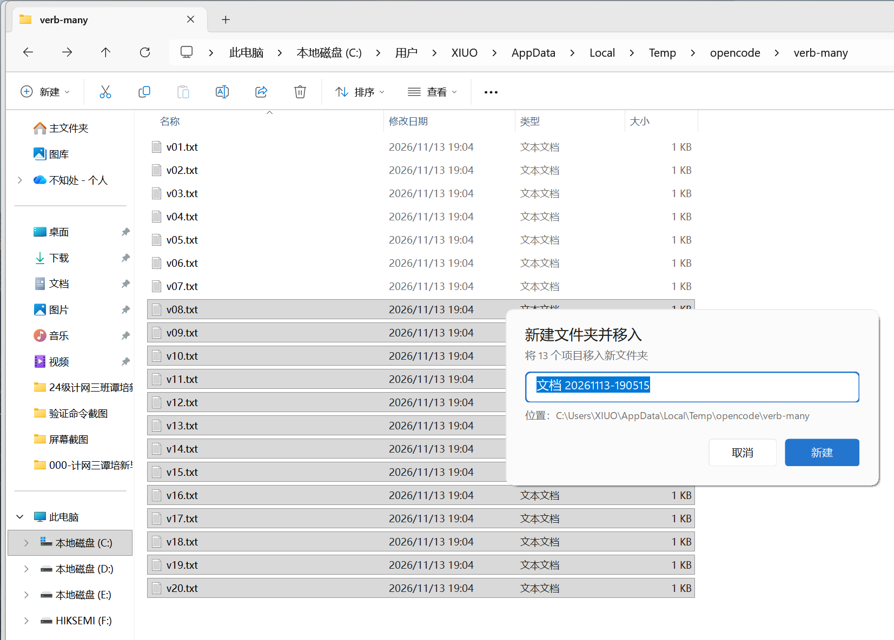
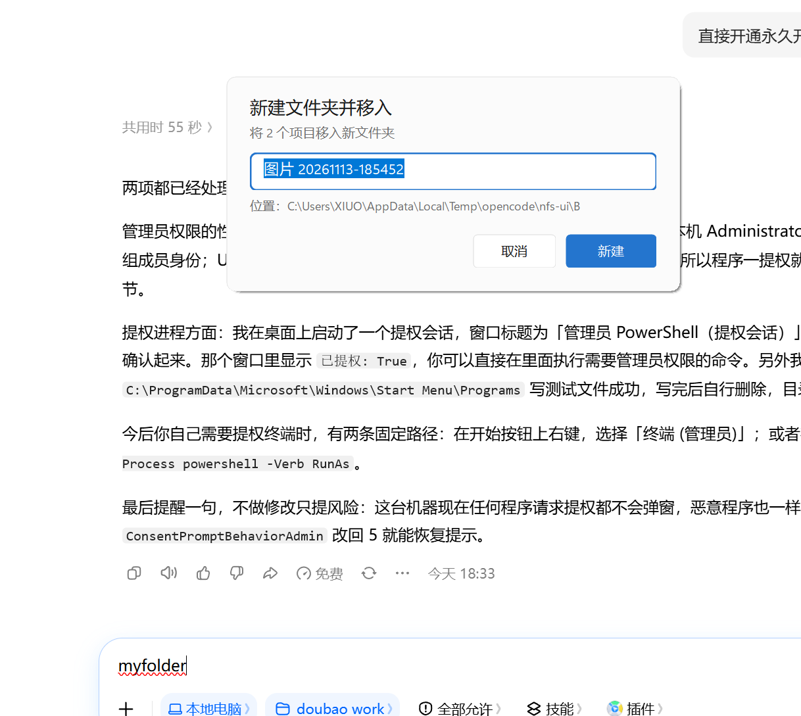
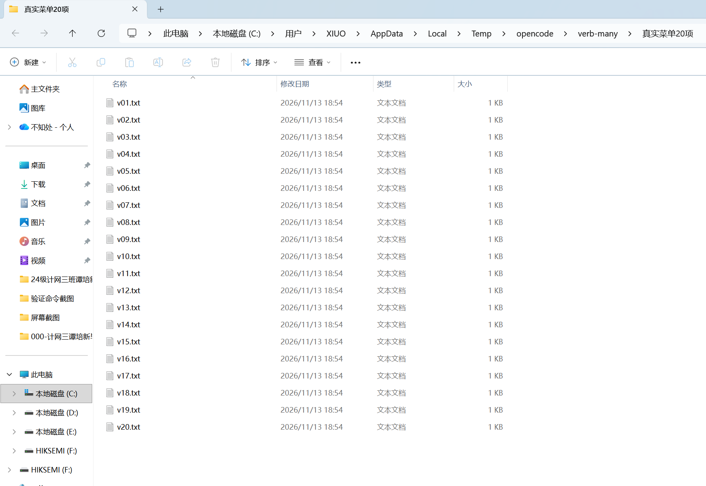
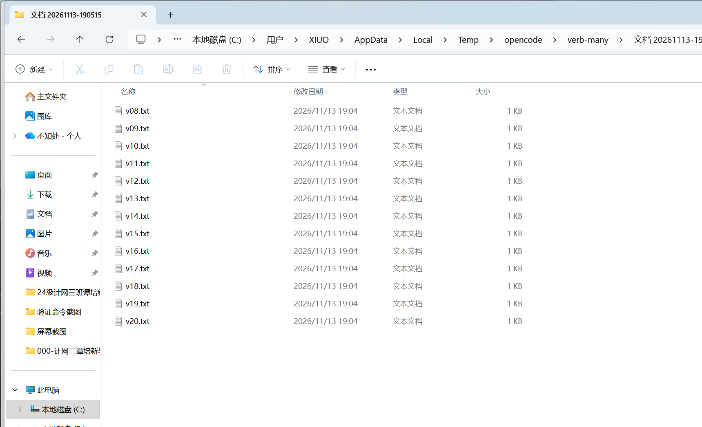
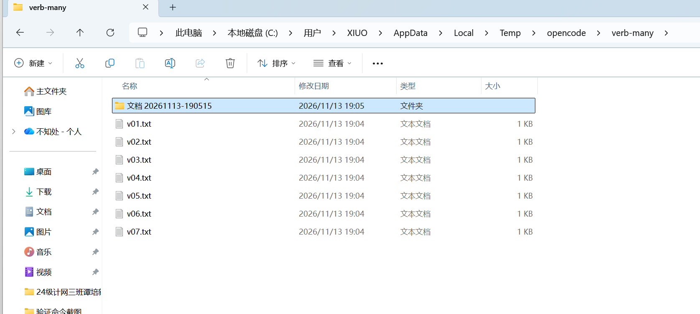
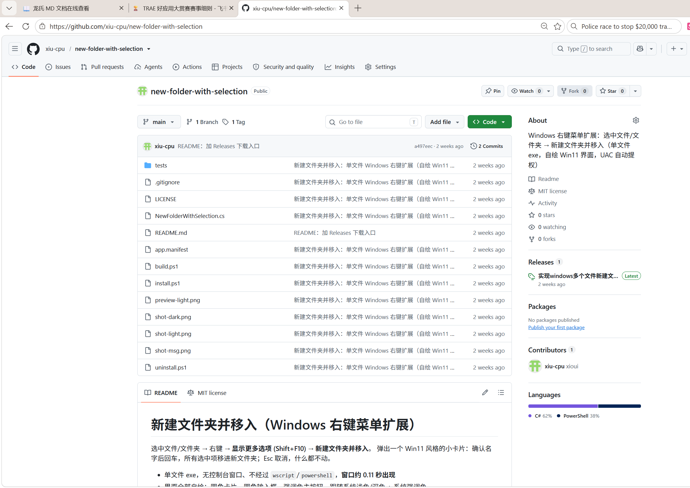

# 新建文件夹并移入（Windows 右键菜单扩展）

选中文件/文件夹 → 右键 → **新建文件夹并移入**。弹出一个 Win11 风格的小卡片，确认名字后回车，
**所有选中项移进新文件夹**；Esc 取消，什么都不动。



*在 Windows 11 上，入口位于「显示更多选项」（Shift+F10）的经典菜单里，可用方向键直接选中。*

- 单文件 exe（约 51 KB），无控制台窗口、不经过 `wscript`/`powershell`，**窗口约 0.11 秒出现**
- 自绘 Win11 风格 UI：圆角、明暗主题跟随系统、Per-Monitor V2 DPI（多屏不同缩放不再糊）
- 多选时聚合批次：Explorer 对每个选中项各调一次，进程之间用队列 + 租约锁合成**一个**文件夹
- 目标目录需要管理员权限时自动 `runas` 提权；提权任务文件带哈希校验
- 长路径（> 260 字符）原生支持，**单个 exe 即可**（不再依赖旁挂的 `.exe.config`）
- 失败项逐条列出原因，空目录自动回滚，全程写日志

---

## 下载

最新版：**[v1.1.0](https://github.com/Xiu-CPU/New-Folder-with-Selection/releases/tag/v1.1.0)**
（`NewFolderWithSelection-v1.1.0.zip`，含 exe + `install.ps1` + `uninstall.ps1` + 本 README）

| 文件 | 大小 | SHA256 |
|---|---|---|
| `NewFolderWithSelection.exe` | 51,200 B | `4c418d7b5d4893d166b8faa03699c255a3e24c7f6272a9f2c3c40d7e0d128010` |
| `NewFolderWithSelection-v1.1.0.zip` | 35,144 B | `34fd728a56268ef2ff475994804a9cc6bb77141eb20f6f91302dae0ed4d64008` |

> 也可以直接用仓库源码编译（见「构建」），两者产物一致。

## 界面

多选 13 项时的确认卡片（默认名是「文档 + 时间戳」，可直接改；名字会按整批自动重算）：



只选 2 项时同样是一个批次、一个文件夹：



---

## 安装

无需安装程序，也不需要管理员权限（注册到 `HKCU`）：

```powershell
powershell -NoProfile -ExecutionPolicy Bypass -File build.ps1     # 编译
powershell -NoProfile -ExecutionPolicy Bypass -File install.ps1   # 注册右键菜单
```

卸载：

```powershell
powershell -NoProfile -ExecutionPolicy Bypass -File uninstall.ps1
```

安装后注册项：

```
HKCU\Software\Classes\AllFilesystemObjects\shell\NewFolderWithSelection
  (默认)  新建文件夹并移入 (&F)
  Icon    imageres.dll,-1003
  command "<仓库目录>\NewFolderWithSelection.exe" "%1"
```

> 为什么是 `AllFilesystemObjects`：文件和文件夹都要能右键；`MultiSelectModel` 用默认的 `Player`，
> Explorer 会把每个选中项各调用一次，程序自己把这一串调用合成一批。

---

## 20 项：15 项上限的处理

Explorer 一次最多把 15 个选中项分别丢给动词，20 项时只会有 15 次调用。程序在批次数达到 15 时
用 Shell COM 读一次真实选中项补齐，最终 20 项全部进**同一个**文件夹：

| 选中 20 项 | 结果 |
|---|---|
|  |  |

新文件夹出现在源目录里，未选中的 7 个文件留在原处：



---

## 这一版修了什么

下面每一条都是「问题 → 原因 → 改法 → 验证数据」。所有改动集中在 `NewFolderWithSelection.cs`
（2066 → 2180 行），测试在 `tests\`。

### 1. 并发追加丢行：33% 的批次被拆成两个文件夹

**问题**：15 个进程同时启动时，偶尔出现「两个新文件夹」，或者某一项根本没被搬走。

**原因**：队列和日志都用 `FileMode.Append`。.NET Framework 的 Append 只是「打开后定位到当前
EOF」，15 个进程同时追加会互相覆盖——后写的把先写的行盖掉，owner 读到的批次就少了几项。

**改法**：用命名互斥体把「打开 → 写 → 关闭」整段串起来。

- `Store.Append`：`Local\NewFolderWithSelection.queue.v1`
- `Loc.Log`：`Local\NewFolderWithSelection.log.v1`
- 拿不到互斥体（被杀的进程留下 `AbandonedMutex`）时按「已获得」继续，不会卡死

**验证**（`tests\regression-concurrent.ps1`，15 个实例在**同一个紧循环里同时 Start**，
不是串行拉起）：

| 版本 | 轮次 | 结果 |
|---|---|---|
| 修复前 | 6 轮 × 15 | **2 轮失败（33.3%）**，表现为 `文件夹=2 移入=14/15` |
| 修复后 | 10 轮 × 15 = 150 次并发追加 | **10/10 通过，0 丢行**，每轮 `文件夹=1 移入=15/15` |

### 2. 崩溃残留的 `queue.txt` 会搬走用户没选的文件

**问题**：上一次运行崩溃留下 `queue.txt`，下一次操作会把里面记录的旧文件也搬进新文件夹。

**原因**：队列行只有路径，没有时间信息，owner 无法区分「本批」和「上一批的残骸」。

**改法**：行格式改成 `<UTC ticks>\t<escaped path>`；owner 只接受「本进程启动前 2 秒之后」
写入的行，无时间戳的旧格式行直接丢弃。

**验证**（同一测试脚本 B 组，伪造两种残留：旧格式行 + 1 小时前的时间戳行）：

| 版本 | 旧格式残留 | 陈旧时间戳行 |
|---|---|---|
| 修复前 | **被搬走（FAIL）** | 恰好躲过 |
| 修复后 | 不动 | 不动 |

### 3. 租约锁：窗口开多久都不会出现第二个 owner

**问题**：锁有一个固定 30 秒的「陈旧」阈值，而提示框可以开很久，超过阈值就可能出现两个 owner。

**原因**：陈旧判断只看锁文件的时间戳，跟 owner 是否真的活着脱钩。

**改法**：owner 起一个心跳线程持续续租（lease），判定看「最后一次心跳」而不是固定时长；
心跳发现锁里的 pid 不是自己时**停止续租，不覆盖**别人的锁；`Release()` 也只在锁仍属于自己时才删。

**验证**：`tests\regression-exe.ps1` 的锁残留组（跑完 `queue.txt` / `owner.lock` 均不存在）；
手工删锁后观察心跳是否重建，未把别人的锁覆盖回来。

### 4. 提权 job 文件不可盲信

**问题**：管理员子进程读 `%TEMP%` 里的 job 文件，同用户的其它进程可以在这中间替换它。

**原因**：文件名可预测 + 没有完整性校验 + 不校验 item 的父目录。

**改法**：

- 文件名用 GUID，不可预测；`FileMode.CreateNew` 防抢占
- 文件内容算哈希，父进程把哈希作为参数传给子进程，子进程**只解析校验通过的这份**
- 校验每个 item 的父目录必须等于 target 的父目录

**验证**：`tests\regression-exe.ps1` 的 `-JobFile` 用例覆盖「哈希正确才执行」「哈希错整份拒绝」。

### 5. 长路径：单 exe 支持 349 字符

**问题**：长路径依赖同目录的 `NewFolderWithSelection.exe.config`，但文档写的是「单文件 exe」，
而且 `.exe.config` 被 `.gitignore` 排除——拷走 exe 就退化，深目录会**静默失败**。

**原因**：.NET Framework 的长路径支持由 `Switch.System.IO.UseLegacyPathHandling` 控制，
默认按「目标框架」决定；不声明框架就按 legacy 处理，`File.Exists` 对 >260 的路径直接返回 false，
项在 `Batch.Merge` 阶段就被过滤掉，不报错也不移动。

**改法**：

- 源码里加 `[assembly: TargetFramework(".NETFramework,Version=v4.8")]`，让运行时默认走长路径分支
- 统一用 `Util.DirExists` / `Util.Full`（必要时加 `\\?\`）判断目录，避免「深目录被当文件走 `File.Move`」

**验证**（349 字符路径，`NFS_QUIET=1` 单选）：

| 版本 | 结果 |
|---|---|
| 带 `.exe.config` | 成功 |
| 不带 `.exe.config`（旧逻辑） | **失败且静默**（退出码 0、无提示） |
| **不带 `.exe.config` + TargetFramework 特性** | **成功** |

`.exe.config` 仍随构建产出，只作为老版本 .NET 的保险，删掉不影响功能。

### 6. 混合 DPI：字体与布局取同一个屏

**问题**：主屏 150%、副屏 100% 时，窗口在副屏上字明显偏大或偏小。

**原因**：布局按「鼠标所在屏」的缩放算，字体却用 `Point` 单位创建——`Point` 在创建时就用
屏幕 DC 的 DPI 定死了像素高度，和窗口所在屏无关。

**改法**：字体一律用 `GraphicsUnit.Pixel` 创建，显式乘 `96/72 × scale`；同一组参数缓存复用
（顺带减少每次重绘 5–10 次 GDI+ 字体创建）。

**验证**：`-Shot` 离屏渲染在 150% 下仍是 690×327，文字像素分布与改前一致；`app.manifest`
里是 `PerMonitorV2`。

### 7. 多选默认名只按第一个文件算

**问题**：默认名按第一个选中项算，和文档里的命名表不符；10 个文件全选时名字是第一个文件的名字。

**改法**：只要用户没改过名字（没打字、也没点进输入框），批次每增长一次就按**整批**重新建议：
单文件 → 文件名；单个文件夹 → 文件夹名；其余 → `文档 + 时间戳`。光标不会因为自动改名而跳。

**验证**：`regression-exe.ps1` 的「建议名」组；`regression-ui.ps1` 的「窗口开着时后续项实时并入」。

### 8. 超长名：先提示，不弹 UAC

**问题**：名字到 300 字符时走提权分支，失败后又把「新建文件夹」当成失败项报一遍。

**原因**：没有在弹 UAC 之前校验 NTFS 的 255 字符上限。

**改法**：建目录之前校验 255（按 UTF-16 code unit，与 NTFS 一致），超了直接给可读提示；
`CON`/`NUL`/`COM1`/控制字符同样在提权之前拦下，不再误报「只读或受保护」。

**验证**：`NFS_NAME=CON` → 不建目录、文件不动、提示「是 Windows 的保留名称」；
300 字符 → 提示「文件夹名最多 255 个字符，当前 300 个」，不进 UAC。

### 9. 全部失败后留下空文件夹

**问题**：所有项都移动失败（比如全被占用），源目录里留下一个空的「新建文件夹」。

**改法**：失败清单覆盖了本批全部项时，回滚**本进程建的那个**空目录（先判空，非空一律不删），
提权路径下由子进程回滚、父进程只报告；文案里不再同时出现「位置：」和「已回滚」。

**验证**（两个文件都被独占，`NFS_QUIET=1`）：`剩余文件夹=0`，提示含「空文件夹已回滚」、
不含「位置：」。

### 10. 跨目录并发：不再「点了没反应」

**问题**：A 目录的窗口开着时，去 B 目录右键，什么都不发生，还要等 1.5 秒。

**原因**：锁是全局的，B 目录的调用被 A 的 owner 挡住，而队列按父目录过滤，B 的项被静默丢弃。

**改法**：拿锁失败时立刻读一次 owner 的目录；不是同一个目录就**立即**弹提示
（「另一个窗口正在处理另一个文件夹：<路径>」），不再干等；同目录仍走原来的等待 + 去重逻辑。

### 11. 失败提示框期间仍持锁

**改法**：所有 `Report(...)` 之前先 `Store.Release()`，提示框弹出时锁已释放，同目录的后续操作
不会被一个没人理的提示框挡住；`Main` 的 `finally` 继续兜底。

### 12. 其它一致性修复

| 项 | 说明 |
|---|---|
| `1812` 无条件读 Shell COM | 只有批次数 ≥ 15（可能被上限截断）才读；多选常见路径省掉一次冷读（本机 100–140 ms） |
| 提权失败文案 | 区分「用户点了否（UAC 1223）」「写任务文件失败」「启动进程失败」「30 秒超时」，后三者带原始原因和日志路径 |
| 等待提权子进程 | `WaitForExit(30000)`，超时 Kill 并给提示，不再无限无响应 |
| `done.txt` | 先写临时文件再 `File.Replace`，peer 不会读到半截文件 |
| 队列轮询 | 记住已读字节偏移只解析新行，`Util.Contains` 的 O(n²) 换成 `HashSet` |
| 失败明细 | 每条原因截断到 100 字，日志路径常显，不再被消息框高度上限裁掉 |
| 日志 | 超过 2 MB 自动转成 `last-run.log.1`，只留一份 |
| `res.txt` 回验 | 声称成功的行回查源路径是否真的消失，被改过的结果不再被当真 |

---

## 测试

全部脚本用 `powershell -NoProfile -ExecutionPolicy Bypass -File tests\<脚本>` 运行。

| 脚本 | 结果 | 内容 |
|---|---|---|
| `regression-exe.ps1` | **41 / 41 PASS** | 多选、中文、空格、子文件夹、无效项、3 进程汇总、迟到调用、`-JobFile` 提权子进程、被占用/只读、建议名、重名/非法字符/空名字、锁无残留（全程不弹窗） |
| `regression-concurrent.ps1` | **17 / 17 PASS** | 15 实例 × 10 轮真并发 + 陈旧队列行 + 残留检查 |
| `regression-elevate.ps1` | **6 / 6 PASS** | 真实 UAC 静默提权到 `C:\Program Files`，测后管理员清理 |
| `regression-over15.ps1` | **PASS** | 真实注册表菜单 + Explorer 全选 20 项 → 20 项全进同一个文件夹 |
| `regression-ui.ps1` | A 组 4/4 PASS | 窗口出现耗时、尺寸、圆角、Esc 取消、实时并入；**默认跳过**，见下 |
| `capture-window.ps1` | PASS | 真实截图 + 自检输入框区域是否画出字 |

**测试安全约定（强制）**：早期版本用 `SendKeys` 往「前台窗口」打字，焦点不在被测窗口时会打进
用户正在使用的编辑器。现在已全部删除 `SendKeys` / `AppActivate` / `SetForegroundWindow` +
模拟输入 / 剪贴板；需要按键时只 `PostMessage` 到**校验过**的句柄（属于被测进程 + 标题匹配），
校验不过就跳过。会弹窗/开 Explorer 的脚本默认不跑，需要显式 `$env:NFS_ALLOW_UI_TESTS=1`。

---

## 构建

```powershell
powershell -NoProfile -ExecutionPolicy Bypass -File build.ps1
```

用系统自带的 `.NET Framework` `csc.exe` 编译，不依赖 .NET SDK / Visual Studio：

```
C:\Windows\Microsoft.NET\Framework64\v4.0.30319\csc.exe
  /target:winexe /optimize+ /platform:anycpu
```

产物：`NewFolderWithSelection.exe`（约 51 KB）+ `NewFolderWithSelection.exe.config`（可选）。

---

## 目录结构

```
NewFolderWithSelection.cs     主程序（单文件，WinForms 自绘）
app.manifest                  Per-Monitor V2 DPI / UAC asInvoker
app.config                    .NET 4.6.2 之前的长路径开关（可选）
build.ps1 / install.ps1       编译 / 注册右键菜单（HKCU）
uninstall.ps1                 卸载
tests/                        回归脚本（见 tests/README.md）
shim/                         IExplorerCommand 代理 DLL（未启用，见下）
package/                      稀疏包定义（未启用，见下）
install-shell-menu.ps1        主菜单安装脚本（未启用，见下）
docs/images/                  README 用图
```

仓库主页：<https://github.com/Xiu-CPU/New-Folder-with-Selection>



---

## 已确认不可行：Win11 新式主菜单（第一屏）

目标是把入口放进 Win11 的第一屏（剪切/复制/重命名/共享/删除 那一屏）。结论：**这台机器上走不通，
已搁置**，旧式菜单入口保留并正常工作。

- 第一屏只认 `IExplorerCommand` + **稀疏 MSIX 包**（sparse package），不能用 `HKCU\...\shell` 动词
- 打包需要 `makeappx` / `signtool`（Windows SDK BuildTools），本机没有；也缺 `dotnet` / `nuget`
- 包必须用**受信任证书**签名并注册，需要开发者模式或 sideload、证书装进用户受信任根——多次弹管理员、
  改系统级设置
- COM 处理器由 `dllhost.exe` 之类的代理宿主加载（这也是 `shim\` 里必须用
  `GetModuleHandleExW(GET_MODULE_HANDLE_EX_FLAG_FROM_ADDRESS)` 取本模块路径的原因）

按「一次 UAC 内能完成、不动系统级设置、不为菜单折腾 Explorer」的止损线，这条路线没有继续。
`shim\`、`package\`、`install-shell-menu.ps1` 原样保留在仓库里，**不启用**，供后人参考。

---

## 已知限制

- 只注册经典菜单（「显示更多选项」）；第一屏见上一节
- 队列与锁是全局单槽（`%TEMP%\NewFolderWithSelection`），两个目录同时操作时后者会看到提示（不会静默失败）
- `res.txt` 由子进程写回，未做 HMAC：能改它的就是同一个用户，回验源路径已消失足够
- 未做 Authenticode 签名（安装位置在用户可写目录，签名挡不住「替换 exe 再等 UAC」）

## 许可证

MIT，见 [LICENSE](LICENSE)。
